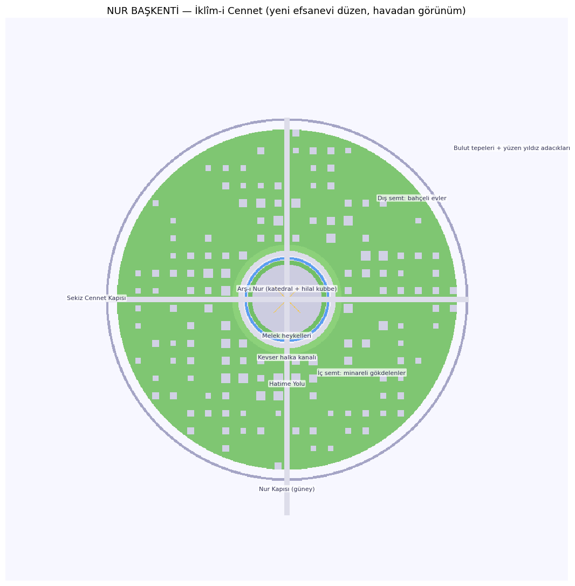

# Cennet Karanlığı (cennetmod)

Minecraft 1.21.1 Forge modu. Yarık Asası ile ulaşılan yeni boyut: **Cennet Karanlığı** ve bulut denizinin üstünde yükselen efsanevi başkent **Nur Başkenti**.



## Efsane: İklîm-i Cennet

Efsaneye göre şehir, yedi katlı bir nur âlemidir; merkezinde **Arş-ı Nur** yükselir, etrafında sekiz Cennet Kapısı sıralanır (eş-Şura 7: "Cennet kapıları").

- **Arş-ı Nur Meydanı:** sekiz köşeli yıldız mozaiği, altın hatlı zemin
- **Katedral:** altın kaburgalı kubbe, tepede hilal tacı ve nur alemi
- **Dört melek heykeli:** cam kanatlı, altın haleli abideler
- **Kevser halka kanalı ve çeşmeleri**, Hatime Yolu fener dizisi
- **İç semt:** balkon kuşaklı minareli gökdelenler, piramit çatılar, nur mızrakları
- **Dış semt:** altın lentonlu, bahçeli köy evleri
- **Sekiz kapılı sur**, güneyde cam mühürlü **Nur Kapısı** (kimlik kartıyla açılır)
- Şehir dışında **yüzen yıldız adacıkları** ve bulut tepeleri

## Teknik

- Prosedürel şehir üretimi (`NurBaskentFeature`): her chunk kendi sütunlarını çizer; tüm yapılar koordinatın saf fonksiyonudur, chunk sınırlarında kusursuz birleşir
- Özel boyutlar, biyomlar, gökyüzü dokuları ve post-shader'lar (nur tonlama)
- Melek Muhafız varlığı, kapı sahnesi ve eşyalar: Yarık Asası, Yıldız Kristali, Nur Kapısı Kimlik Kartı

## Derleme

Java 21 gerekir. Bilgisayarda:

```bash
gradle wrapper --gradle-version 8.8   # ilk kurulumda
./gradlew build                       # jar: build/libs/cennetmod-1.1.0.jar
```

> Not: Termux'ta ForgeGradle derlemesi çok ağırdır; derlemeyi bilgisayarda yapman önerilir. GitHub'a yüklemek için derlemeye gerek yok.

## Termux'tan GitHub'a yükleme

1. Depoyu GitHub'da oluştur: https://github.com/new → isim: `cennetmod` (README oluşturma, boş bırak)
2. Telefonda bu arşivi indir (`cennetmod-github.tar.gz`) ve Termux'ta:

```bash
pkg update && pkg install git tar
termux-setup-storage          # izin iste (allow)
cp /sdcard/Download/cennetmod-github.tar.gz ~/
cd ~
tar xzf cennetmod-github.tar.gz
cd cennetmod

git init
git add .
git commit -m "Cennet Karanlığı: Nur Başkenti efsanevi tasarım"
git branch -M main
git remote add origin https://github.com/KULLANICI_ADIN/cennetmod.git
git push -u origin main
```

**Kimlik doğrulama:** GitHub artık şifre kabul etmez. İki seçenek:
- GitHub'da `Settings → Developer settings → Personal access tokens → Tokens (classic)` → `repo` izniyle token üret; push yaparken **şifre yerine bu token**'ı gir.
- Ya da: `pkg install gh && gh auth login` (GitHub CLI ile tarayıcıda giriş).

## Lisans

All Rights Reserved.
